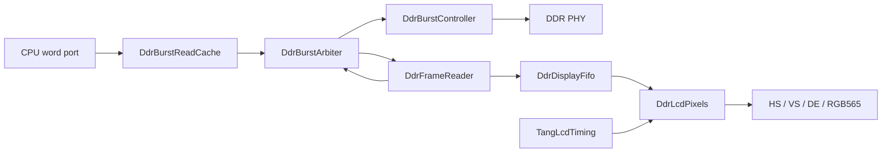

# DDR framebufferからLCDへの読み出し

## 現在地（2026-10-12）

CPUと表示のDDR仲裁、連続frame読出し、非同期FIFO、RGB565出力をVerylで実装した。
実際の`DdrBurstController`と接続するシミュレーションで、800×480の連続3 frame、
CPU要求の継続、DDR refreshを同時に検証した。GOWIN単体合成では表示経路のFIFOが
4個のBSRAMに割り当てられた。

続いて`TangLinuxLcdTop`を追加し、CPU・DDR PHY・pixel PLL・LCDピンを接続した。
全体の配置配線でsetup/hold違反0を確認した。Linuxのframebuffer予約、fbcon、
`/dev/fb0`へ描画するGUIを実装し、シミュレーションでは色変更・移動・終了後のシェル復帰と
framebuffer内容の照合まで成功した。実機検証結果は末尾に記録する。

## 回路と転送契約



`DdrLcdStream`はreader・FIFO・timing・pixelsをまとめる。CPU word portとPHYは
上図の接続先であり、今回の追加回路には含まない。結合TBではCPU側からburst要求を生成し、
PHYの代わりにDDRコマンドとlane応答のモデルを接続する。

| モジュール | 契約 |
| --- | --- |
| `DdrBurstReadCache` | CPU側の16 byte × 16 line。read hitをDDRへ流さず、書込みはindexを無効化してDDRへ通す。CPUが唯一のwriterであることが前提 |
| `DdrBurstArbiter` | 同一メモリclockの2 clientを1 controllerへ接続。client 0がCPU、1が表示。要求を保持し、応答をclientごとの独立slotへ格納する。CPU応答が停止しても表示とrefreshを進められる |
| `DdrFrameReader` | idle時のstartでDDR相対baseとburst数を固定。16 byte単位、1要求ずつ発行し、128 bitデータとfirst/lastを出力。最終データの消費までbusyを維持する |
| `DdrDisplayFifo` | 256 entryのdual-clock RAMと1 entryの読出しレジスタ。表示経路は128 bitの画素＋first/lastの130 bit幅。`o_level`はメモリ側から見たRAM占有数で、同期遅延を含み、読出しレジスタを含まない |
| `DdrLcdPixels` | burstの下位16 bitから順に出力。HS/VS/DE/RGBを同じ1 pixel clock遅延で登録。欠落・不正tag時は残りのframeを黒にし、次のfirst tagを待って次のraster先頭から復帰 |
| `DdrLcdStream` | 800×480、48,000 burstを繰返し読み出す。FIFO占有数が224未満なら表示を優先。メモリerrorをresetまで保持し、pixel側に欠落・tag異常の飽和counterを出す |

FIFOが不足するときは表示を優先し、それ以外の同時要求は交互に選択する。
表示応答slotが有効でurgentな間は、CPUの新規要求を保留する。readerが応答を消費して
次の要求を出す1 cycleをCPU取引で占有すると、各burstの間にCPUが入り表示帯域が不足したためである。
urgentは1 cycle登録してFIFO占有数の計算を仲裁経路から分離する。224 burstの閾値で
この遅延を吸収できることを結合試験で確認した。
表示優先中でも、受理済みのCPU取引は取り消さない。表示がサービスを必要としないときは
urgentを解除する必要がある。

readerは不整列base、burst数0、128 MiB境界を越える範囲を拒否する。backend errorでは
当該burstを0に置換して位置とtagを保持し、frame errorを立てる。busy中のstartや
設定入力の変化は転送先を変更しない。resetはreader・arbiter・controllerで共通にし、
過去の応答を新しいframeへ混入させない。

FIFOは共通の非同期resetを各clockで2段同期して解除する。片側clockが停止したままでも
resetをassertできる。RAM内容をresetせず、pointerとvalidで無効データを除外する。
Gray pointerは2段同期する。`linux_lcd.sdc`はメモリ・pixel領域間の最大遅延を両方向とも
9 nsへ制約し、速い側の周期10.101 nsより短くすることでbus skewも制限する。
両PLLの位相関係によるhold検査は除外し、最大遅延の検査を残す。

`DdrLcdStream.i_enable`はDDR training完了・framebuffer初期化後にassertし、共通resetまで
維持する契約とする。動作中のdisable/re-enableによるframe取消し、page flipは未実装。
status出力はportに記載したclock領域に属する。統合回路はunderflow counterをpixel領域で
stickyな1 bitへ変換し、メモリerrorとそれぞれ2段同期してCPUへ渡す。

## 画面形式とメモリ

- 800×480、RGB565 little-endian、stride 1,600 byte、frame全体768,000 byte。
- 33 MHz pixel clock、総周期1,056×505、約61.88 frame/s。active期間は66 MB/s、
  blankingを含む平均読出し帯域は約47.52 MB/s。
- 既定baseはDDR相対`0x07c00000`、CPU物理アドレスなら`0x87c00000`。
  使用範囲は`[0x87c00000, 0x87cbb800)`である。
- 実機DTSの`reserved-memory`で`0x87c00000`から1 MiBを`no-map`として予約する。
  allocationとSystem RAM resourceの両方から除外し、simplefbが領域を確保できるようにする。
  既存DTB・boot stack用の上位2 MiB予約とは別に扱う。
- FIFOは画素データ4 KiBとtag 64 byteをRAMに保持する。読出しレジスタとserializerにも
  最大1 burstずつ保持できる。frame全体をFPGA内RAMへ複製する方式ではない。

## 検証

固定開発コンテナ（README記載Veryl v0.20.3 / Verilator 5.051）で実行する。

```bash
make lint ddr-display-test ddr-burst-controller-test \
    lcd-test lcd-mmio-test lcd-reset-test lcd-soc-test
```

`ddr-display-test`は以下4種類を実行し、`make all`と通常CIの`verify`に含める。
合成RTLは全てVerylであり、生成SVを手編集しない。TBにはSVを使う。独立clock・
停止clockのreset、外部DDRコマンドモデルとlane応答、画素ごとのscoreboard、
異常tag・欠落の注入を制御するためである。clock比を上書きするFIFO試験は、
Veryl組込みTBの多重topでのparameter上書き制約を避け、単独topでビルドする。

| TB / target | 検査内容・結果 |
| --- | --- |
| `tb_ddr_display_fifo` / `ddr-display-fifo-test` | clock半周期5/15、19/5、7/11の3通り。257 entry容量、full/empty、pointer wrap、5,000以上の転送、応答保持、各clockを止めたreset後の旧データ排除。全て成功 |
| `tb_ddr_lcd_pixels` / `ddr-lcd-pixels-test` | 5 frameの全同期信号と全画素。frame 1でburst欠落、frame 3で早すぎるlastを注入。後続を黒表示しframe 2/4で復帰。counterは0/1/1/2/2 |
| `tb_ddr_display` | 実controller＋arbiter＋reader＋FIFO。CPU masked write/read、応答長期停止、表示3 frame、refresh期限・tRFC/tRP/tRCD、range拒否・lane timeout・reset取消し。全て成功 |
| `tb_ddr_lcd_stream` / `ddr-lcd-stream-test` | 実controller＋arbiter＋連続scanout全体。独立clockの位相をずらし、3 frameそれぞれ異なるデータで全384,000画素、HS/VS/DEを照合。CPU要求を継続し、欠落・メモリerrorとも0 |

結合試験は99:33 MHzと同じ3:1のclock比でモデル化する。最終scanout試験では
active期間のFIFO RAM占有数最小値は各frameとも208 burst、CPU応答完了数は
8,324 / 8,580 / 8,579、累積refresh数は6,092 / 12,184 / 18,276だった。
別のmasked write/read試験では最終drain期間を除く最小占有数209 burst、
CPU応答9,117 / 9,119 / 9,119を確認した。
CPU応答数はTBのburst取引数であり、実CPUの命令性能やLinux描画性能を示す値ではない。
モデルはDDRコマンドからアドレスを復元して照合し、laneを別cycleで返す。
PHY波形、メタステーブル状態、実機のbandwidthや電気的余裕は対象外である。

## 単体合成

開発コンテナで`make veryl-build`を完了してから、既存の固定GOWIN専用コンテナ内で実行する。
合成中は`target/`を更新しない。

```bash
bash scripts/check_display_fifo_synth.sh fifo
bash scripts/check_display_fifo_synth.sh stream
```

GOWIN V1.9.11.03 Education、`GW2A-LV18PG256C8/I7`での単体合成結果
（`c0403c3`時点、urgent登録追加前）:

| top | Logic（GOWIN集計） | Register | BSRAM |
| --- | --- | --- | --- |
| `DdrDisplayFifo`（128 bit） | 77（59 LUT / 18 ALU） | 75 | 4 SDPB |
| `DdrLcdStream`（130 bit FIFOを含む） | 743（684 LUT / 59 ALU） | 476 | 4 SDPX9B |

スクリプトは合成完了・errorなし・新規report・BSRAM 4個を検査する。
結果は`sim/fpga/display_fifo/`、`sim/fpga/display_stream/`へ保存する。
単体topのI/Oは内部portを含む。基板ピンへの配置、CPU/PHYを含む全体の資源使用量、
99 MHz / 33 MHzでのSTAとは区別する。既存`TangLcdTiming`のcounter加算には
GOWINの幅切詰め警告が2件あり、counter範囲とwrapはLCD回帰で検証する。

## Linux用回路への統合

`TangLinuxLcdTop`は`WITH_LCD=1`の`DdrLinuxProbe`を使う。既存`TangLinuxTop`は
表示なしの構成を維持する。共通DDR診断トップに追加したLCD portは、既存の各診断では
未接続にする。初期化専用ビルドは`TangDdrInitTop`で未使用portを内部に閉じる。

ブートROMのLCD版は全768,000 byteへ8色の縦barを書き込み、fenceの後にenableを設定する。
UARTの`VBL1`通知はその後に送る。LinuxのImage/DTB転送とCRC検査の間も表示読出しは継続する。
UART専用ROMの動作は変更しない。

`0x11200000`の32 bit制御・状態レジスタはLCD構成だけで有効:

| bit | 読出し | 書込み |
| --- | --- | --- |
| 0 | 表示enable | byte lane 0のbit 0が1ならset。0書込みでは解除しない |
| 1 | DDR読出しerror（sticky） | 無視 |
| 2 | underflow / frame tag異常（sticky） | 無視 |
| 31:3 | 0 | 無視 |

解除はCPU・controller・scanout共通resetで行う。pixel PLL lock喪失も共通resetへ含める。
LinuxのLCD専用`lcdstat`コマンドは、このレジスタが1（enabled、errorなし）であることを確認する。
これはTang専用のNOMMU診断であり、汎用Linux向けのデバイスドライバではない。

LCDのN9ピンはSSPIと兼用のため、LCDビルドだけ`set_option -use_sspi_as_gpio 1`とする。
JTAGはGPIO化しない。設定の定義は[GOWIN Tcl Commands](https://www.gowinsemi.com/upload/database_doc/3262/document/68b8a001a6a92.pdf)を参照する。

最初の統合版にはsetup 277 endpointの違反（最悪−0.478 ns）があり、実機へは書き込まなかった。
urgentを登録した初回実機試験版（CPUキャッシュ追加前）の全体配置配線は14,233 Logic、5,031 Register、5 BSRAM、2 rPLL。
CPU 27 MHz、DDR 396/99 MHz、pixel 33 MHzでsetup/hold違反0、最悪setup slack +0.018 ns。
報告上のFmaxはCPU 27.116 MHz、controller 99.179 MHz、pixel 88.520 MHzである。
これは指定デバイス・制約でのSTAであり、LCDコネクタからパネル内部までの遅延を測定した値ではない。

キャッシュ追加版は15,185 Logic、5,475 Register、5 BSRAM、2 rPLL。
クロック条件は同じでsetup/hold違反0、最悪setup slack +0.010 ns。
FmaxはCPU 27.007 MHz、controller 99.102 MHz、pixel 87.415 MHzであり、
CPUとcontrollerの余裕は小さい。変更のたびに全体の配置配線とSTAをやり直す。

### fbconとGUI

`linux/tang_primer_20k_lcd.dts`はUART用DTSを含み、`/chosen`に800×480・stride 1600・
`r5g6b5`のsimple-framebufferを追加する。`ranges`によるアドレス変換を明示する。
`console=tty0 console=ttyS0,115200`により、カーネルログを両方へ出し、`/dev/console`はUARTとする。
Linux v6.12の[定義](https://github.com/torvalds/linux/blob/v6.12/Documentation/devicetree/bindings/display/simple-framebuffer.yaml)と
[simplefb実装](https://github.com/torvalds/linux/blob/v6.12/drivers/video/fbdev/simplefb.c)を基にした。

`WITH_LCD=1`のカーネルはVT・FB_SIMPLE・FRAMEBUFFER_CONSOLE・8×16 fontを有効にする。
UART shellの`gui`は別のFDPICプロセス`/bin/fbui`を起動する。アプリはfbdev ioctlで
800×480 RGB565・stride 1600を確認し、`/dev/fb0`へのwriteで描画する。
3色の選択欄と矩形を表示し、UARTの`r/g/b`で色選択、`w/a/s/d`で移動、`q`で終了する。
各コマンドはEnterで確定する。マウス・タッチ入力やwindow systemは含まない。
fbconとの排他的な画面所有やpage flipも未実装であり、kernel consoleが出力すると描画に重なる。

GUI結合試験は起動、緑への変更、右移動、子プロセス終了後のshell復帰を実行する。
Verilatorのメモリモデルから各描画完了時のRGB565データを取り出し、選択枠・矩形・色変更・
移動前の領域の消去を独立に照合する。PNGはシミュレーション上のframebufferの可視化であり、
実機LCDの撮影画像ではない。

2026-10-13に利用者が実機LCD上のブートログ文字を視認した。GUI画面の実機目視は未確認である。
`make linux-lcd-boot`はGUI開始前のframebufferも`logs/linux/fbui-bootlog.rgb565`へ保存し、
固定Linuxソースの8×16フォントと照合して`simplefb registered!`と`Run /init as init process`を
画素から検出する。UART文字列とは独立した検証であり、同日の結合試験は成功した。
復号した文字列と可視化は同名の`.txt`と`.png`へ保存する。

### 再現手順

固定開発コンテナで実行する（依存追加なし）。既存UART版のImageを上書きせず別directoryへ出す。
`make linux-lcd-build linux-lcd-boot`でもbuildとGUI結合試験を実行できる。
通常PRのCIにはROM・表示RTL・console driverの単体試験を、schedule / workflow_dispatchの
`linux-boot` jobにはfbcon / GUI起動とframebuffer capture照合までを組み込む。

```bash
WITH_LCD=1 bash scripts/build_tang_boot.sh
make lint tang-boot-test tang-lcd-boot-test ddr-display-test linux-console-test
WITH_LCD=1 LINUX_OUT="$PWD/sim/linux-lcd-gui" LINUX_SRC=/opt/src/linux bash linux/build_linux.sh
python3 scripts/pack_tang_boot.py sim/linux-lcd-gui/Image \
    sim/linux-lcd-gui/tang_primer_20k_lcd.dtb sim/tang-linux-lcd-gui.vbl
make tb-fast
python3 scripts/linux_console_test.py --lcd-gui sim/tb_core_fast \
    +kernel=sim/linux-lcd-gui/Image +dtb=sim/linux-lcd-gui/tang_primer_20k_lcd.dtb \
    +ramsize_mb=128 +mtimediv=64 +timeout=8000000000 \
    +conlog=logs/linux/lcd-gui-console.log +fb_capture=logs/linux/fbui
python3 scripts/check_fbui_capture.py logs/linux/fbui
```

固定GOWINコンテナで`LINUX_LCD=1 bash scripts/build_ddr_mpr.sh`を実行し、成功後にホストで書き込む。
`boot-tang.ps1`の既定は従来のUART専用版であり、LCD版には`-Platform Lcd`を指定する。

```powershell
./scripts/boot-tang.ps1 -Suite <Windows-OSS-CAD-Suite> -Port COM4 -Platform Lcd `
    -Package sim/tang-linux-lcd-gui.vbl -CaptureSeconds 240 `
    -ExpectedText 'veryl$ ' -ConsoleCommand lcdstat `
    -CommandExpectedText 'LCD scanout status: OK' -KeepRunning
./scripts/test-tang-lcd-gui.ps1 -Port COM4
```

後者は既に起動したLinuxへUARTで入力し、色変更・移動・終了・errorなしを確認後、GUIを再表示する。
書込みやコンテナ再起動は行わない。UARTログと判定結果は`logs/board/`へ保存する。
元の矩形デモへ戻す場合は`test-board.ps1 -Mode LcdSoc`を使う。

### 統合版の検証記録

ブートROM結合試験は全384,000画素の初期値、enable/status、byte mask、sticky enable、
共通resetを確認した。UART専用ROMの3 baud条件の回帰、表示経路の結合試験、
初期化専用回路の配置配線も成功した。
最終の予約定義を使うfbcon付きLinuxは、シミュレーションで`/init`、Mandelbrot、
donut 24 frame、SYSCON poweroffまで635,207,881 cycle / 218,280,750 retireで成功した。
GUI版は778,942,200 cycle / 282,370,208 retireでGUI操作・Mandelbrot・donut・poweroffを通過し、
3枚のframebuffer captureの領域照合も成功した。

初回のLCD統合実機試験（`20261012-150157-LinuxBoot`）はImage/DTB転送と読戻しCRC、
Linux entryまで成功したが、240秒のcapture内にshellへ到達しなかった。
最後のUART行は`[30.578145] cpu0: Ratio of byte access time ...`である。
表示DMA併用時の起動時間はUART専用版より増加していた。
メモリ競合やtimer処理の影響が考えられるが、このログだけでは停止原因を確定できない。

CPU側のDDR burst経路に`DdrBurstReadCache`を追加した。16 byte × 16 lineのdirect-mapped
read cacheで、同一burst内の命令・データを再利用する。書込みは常にDDRへ送り、受理時に
対応indexを無効化する。書込み失敗時も無効化し、読出し失敗はcacheへ登録しない。
非整列要求はcacheを迂回し、controllerでのerror判定を保持する。命令・データで共通の
cacheを使うため、CPUによる自己書換えも同じ無効化規則に従う。
training完了後のDDR writerがCPUだけであることが前提であり、外部DMA writer追加時には
coherency制御が必要になる。resetはCPU接続・arbiter・controllerと共通にする。
UART専用構成には挿入しない。

`make ddr-burst-cache-test`はhit/miss、index衝突、部分書込み、error、backpressure、
応答保持中／要求処理中のreset、4回の読み出しで1回だけDDRへ要求することを検証する。
`make ddr-lcd-stream-test`はcacheなし／ありの両構成で連続3 frameの全画素とrefreshを照合する。
cacheありの試験ではFIFO最少239 burst、CPU応答533,263 / 533,280 / 533,280回を確認した。
これは同一アドレスを繰り返す合成負荷であり、Linuxの処理性能を表す値ではない。
`make tang-lcd-boot-test`はCPU・CDC・cacheを通す構成でもROMからの全画素初期化、
UART転送、CRC／範囲外拒否、DDRプログラム実行、timer、PLIC、reset／errorを確認する。
追加SVトップはVerylモジュールの接続だけを行い、RTLを再実装していない。

キャッシュ追加後の実機試験`20261012-152400-LinuxBoot`では、同一Image/DTBで前回の停止箇所を通過した。
simplefbは`[70.666712]`で登録され、100×30文字のfbconへ切り替わった。
`[115.656123] Run /init as init process`の後にUART shellへ到達し、`lcdstat`が
`LCD scanout status: OK`（enabled、DDR errorなし、underflow/tag errorなし）を返した。
転送と起動を含む実行時間は460.847秒。

続く`20261012-153151-LinuxLcdGui`はGUI起動・緑への変更・右移動・終了後のshell復帰・
`lcdstat`正常・GUI再起動の全項目を通過した。パネルの見た目の目視確認は行っていない。
最初の描画は145.463秒、色変更128.901秒、移動148.668秒、再起動152.266秒を要したため、
画素ごとの領域判定を行単位に変更した。最適化前後の3画面はシミュレーションでbyte単位に完全一致した。
最適化版のGUI・Mandelbrot・donut 24 frame・poweroff回帰も668,891,808 cycle /
229,651,709 retireで成功した。GUI以外のkernel設定と表示RTLは変更していない。
実機の再起動試験`20261012-154209-LinuxBoot`も、CRC検査、fbcon登録、
`[114.772862] Run /init as init process`、shell到達、`lcdstat`正常まで成功した。
転送と起動を含む実行時間は466.771秒。以下の最適化後SHA256がこの試験の成果物に対応する。

最終の実機GUI試験`20261012-155012-LinuxLcdGui`も全7項目を通過した。
色変更・移動・終了後の`lcdstat`は正常で、最後にGUIを再起動して残した。

| UART入力から完了通知まで | 最適化前 | 最適化後 |
| --- | ---: | ---: |
| GUI初回起動・描画 | 145.463秒 | 65.612秒 |
| 緑への変更 | 128.901秒 | 64.826秒 |
| 右への移動 | 148.668秒 | 61.499秒 |
| 終了・shell復帰 | 20.318秒 | 7.090秒 |
| GUI再起動・描画 | 152.266秒 | 87.823秒 |

各1回の測定であり、UART・プロセス起動／終了・kernel処理の時間を含む。
全画面の再描画にはまだ時間がかかるため、部分更新とCPU/DDR性能、fbconとの画面所有は今後の改善項目とする。
実機で確認したのはプロセスの描画完了・操作応答とscanoutの状態であり、パネルの目視確認は含まない。

| 成果物 | SHA256 |
| --- | --- |
| 初回LCD統合bitstream（shell未到達） | `86be7a5371cf5cc54f3851c5150dca950959ff4a73245dc7d1ab509472ba534d` |
| CPU read cache追加bitstream | `88f8ae1fa6f66ce11591b471a93fac2305538143954c0ff3749a1aa04bad1ef5` |
| LCD ROM hex | `5b2d421bd20e73c970f90430de6d06d7f97731ee079370ad5f778c521e97be88` |
| 初回GUI版Linux Image | `b0d44a589d594e9e1ab6cd1a872510fed0ad60c986a83ad7c0917935162acc4d` |
| 描画最適化後のLinux Image | `ca8e5ad01b24a53b3830345f6c43d4a1eec641fce74f9e2d25c2c7ed3ba8a331` |
| LCD DTB | `c0dc6243937dbd60d5e5080ffe255185850caec7c7eee2e4ec5a413737e0f47c` |
| 初回UART転送package | `700f6501532dcc53733d402697837475a9d79526928b48813236969e8250bac1` |
| 描画最適化後のUART転送package | `fb22379d6ef163cde8c94836887e4267e097213d19415514fd097f420f273518` |
