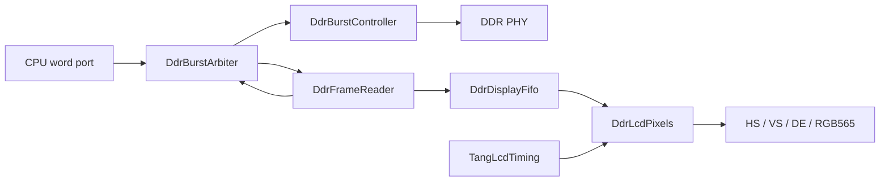

# DDR framebufferからLCDへの読み出し

## 現在地（2026-10-12）

CPUと表示のDDR仲裁、連続frame読出し、非同期FIFO、RGB565出力をVerylで実装した。
実際の`DdrBurstController`と接続するシミュレーションで、800×480の連続3 frame、
CPU要求の継続、DDR refreshを同時に検証した。GOWIN単体合成では表示経路のFIFOが
4個のBSRAMに割り当てられた。

この経路はまだ`TangLinuxTop`に接続していない。LCD用PLL・ピン・CDC制約の追加と
配置配線、実機試験、Linuxのframebuffer予約・fbconは残る。
Linuxの実機確認済み出力先は[UART](tang-uart-boot.md)であり、LCD bootlog・GUIの
実機成功を示す結果ではない。今回、実機への新しい回路の書込みは行っていない。

## 回路と転送契約



`DdrLcdStream`はreader・FIFO・timing・pixelsをまとめる。CPU word portとPHYは
上図の接続先であり、今回の追加回路には含まない。結合TBではCPU側からburst要求を生成し、
PHYの代わりにDDRコマンドとlane応答のモデルを接続する。

| モジュール | 契約 |
| --- | --- |
| `DdrBurstArbiter` | 同一メモリclockの2 clientを1 controllerへ接続。client 0がCPU、1が表示。要求を保持し、応答をclientごとの独立slotへ格納する。CPU応答が停止しても表示とrefreshを進められる |
| `DdrFrameReader` | idle時のstartでDDR相対baseとburst数を固定。16 byte単位、1要求ずつ発行し、128 bitデータとfirst/lastを出力。最終データの消費までbusyを維持する |
| `DdrDisplayFifo` | 256 entryのdual-clock RAMと1 entryの読出しレジスタ。表示経路は128 bitの画素＋first/lastの130 bit幅。`o_level`はメモリ側から見たRAM占有数で、同期遅延を含み、読出しレジスタを含まない |
| `DdrLcdPixels` | burstの下位16 bitから順に出力。HS/VS/DE/RGBを同じ1 pixel clock遅延で登録。欠落・不正tag時は残りのframeを黒にし、次のfirst tagを待って次のraster先頭から復帰 |
| `DdrLcdStream` | 800×480、48,000 burstを繰返し読み出す。FIFO占有数が224未満なら表示を優先。メモリerrorをresetまで保持し、pixel側に欠落・tag異常の飽和counterを出す |

FIFOが不足するときは表示を優先し、それ以外の同時要求は交互に選択する。
表示応答slotが有効でurgentな間は、CPUの新規要求を保留する。readerが応答を消費して
次の要求を出す1 cycleをCPU取引で占有すると、各burstの間にCPUが入り表示帯域が不足したためである。
表示優先中でも、受理済みのCPU取引は取り消さない。表示がサービスを必要としないときは
urgentを解除する必要がある。

readerは不整列base、burst数0、128 MiB境界を越える範囲を拒否する。backend errorでは
当該burstを0に置換して位置とtagを保持し、frame errorを立てる。busy中のstartや
設定入力の変化は転送先を変更しない。resetはreader・arbiter・controllerで共通にし、
過去の応答を新しいframeへ混入させない。

FIFOは共通の非同期resetを各clockで2段同期して解除する。片側clockが停止したままでも
resetをassertできる。RAM内容をresetせず、pointerとvalidで無効データを除外する。
Gray pointerは2段同期する。基板統合時には各Gray busの最大遅延とskewを送出clockの
周期未満へ制約する必要がある。RTLのCDC注記・シミュレーションだけでは物理条件を保証しない。

`DdrLcdStream.i_enable`はDDR training完了・framebuffer初期化後にassertし、共通resetまで
維持する契約とする。動作中のdisable/re-enableによるframe取消し、page flip、MMIO設定は未実装。
status出力はportに記載したclock領域に属し、CPUから読む場合は別途CDCが必要になる。

## 画面形式とメモリ

- 800×480、RGB565 little-endian、stride 1,600 byte、frame全体768,000 byte。
- 33 MHz pixel clock、総周期1,056×505、約61.88 frame/s。active期間は66 MB/s、
  blankingを含む平均読出し帯域は約47.52 MB/s。
- 既定baseはDDR相対`0x07c00000`、CPU物理アドレスなら`0x87c00000`。
  使用範囲は`[0x87c00000, 0x87cbb800)`である。
- **この範囲は現行Linux DTSでは予約されていない。** 実機への接続前に予約と初期化を行う。
  既存DTB・boot stack用の上位2 MiB予約とは別に扱う。
- FIFOは画素データ4 KiBとtag 64 byteをRAMに保持する。読出しレジスタとserializerにも
  最大1 burstずつ保持できる。frame全体をFPGA内RAMへ複製する方式ではない。

## 検証

固定開発コンテナ（README記載Veryl v0.20.3 / Verilator 5.051）で実行する。

```bash
make lint ddr-display-test ddr-burst-controller-test \
    lcd-test lcd-mmio-test lcd-reset-test lcd-soc-test
```

`ddr-display-test`は以下4種類を実行し、`make all`と通常CIの`verify`に含める。
合成RTLは全てVerylであり、生成SVを手編集しない。TBにはSVを使う。独立clock・
停止clockのreset、外部DDRコマンドモデルとlane応答、画素ごとのscoreboard、
異常tag・欠落の注入を制御するためである。clock比を上書きするFIFO試験は、
Veryl組込みTBの多重topでのparameter上書き制約を避け、単独topでビルドする。

| TB / target | 検査内容・結果 |
| --- | --- |
| `tb_ddr_display_fifo` / `ddr-display-fifo-test` | clock半周期5/15、19/5、7/11の3通り。257 entry容量、full/empty、pointer wrap、5,000以上の転送、応答保持、各clockを止めたreset後の旧データ排除。全て成功 |
| `tb_ddr_lcd_pixels` / `ddr-lcd-pixels-test` | 5 frameの全同期信号と全画素。frame 1でburst欠落、frame 3で早すぎるlastを注入。後続を黒表示しframe 2/4で復帰。counterは0/1/1/2/2 |
| `tb_ddr_display` | 実controller＋arbiter＋reader＋FIFO。CPU masked write/read、応答長期停止、表示3 frame、refresh期限・tRFC/tRP/tRCD、range拒否・lane timeout・reset取消し。全て成功 |
| `tb_ddr_lcd_stream` / `ddr-lcd-stream-test` | 実controller＋arbiter＋連続scanout全体。独立clockの位相をずらし、3 frameそれぞれ異なるデータで全384,000画素、HS/VS/DEを照合。CPU要求を継続し、欠落・メモリerrorとも0 |

結合試験は99:33 MHzと同じ3:1のclock比でモデル化する。最終scanout試験では
active期間のFIFO RAM占有数最小値は各frameとも208 burst、CPU応答完了数は
8,324 / 8,580 / 8,579、累積refresh数は6,092 / 12,184 / 18,276だった。
別のmasked write/read試験では最終drain期間を除く最小占有数209 burst、
CPU応答9,117 / 9,119 / 9,119を確認した。
CPU応答数はTBのburst取引数であり、実CPUの命令性能やLinux描画性能を示す値ではない。
モデルはDDRコマンドからアドレスを復元して照合し、laneを別cycleで返す。
PHY波形、メタステーブル状態、実機のbandwidthや電気的余裕は対象外である。

## 単体合成

開発コンテナで`make veryl-build`を完了してから、既存の固定GOWIN専用コンテナ内で実行する。
合成中は`target/`を更新しない。

```bash
bash scripts/check_display_fifo_synth.sh fifo
bash scripts/check_display_fifo_synth.sh stream
```

GOWIN V1.9.11.03 Education、`GW2A-LV18PG256C8/I7`での単体合成結果:

| top | Logic（GOWIN集計） | Register | BSRAM |
| --- | --- | --- | --- |
| `DdrDisplayFifo`（128 bit） | 77（59 LUT / 18 ALU） | 75 | 4 SDPB |
| `DdrLcdStream`（130 bit FIFOを含む） | 743（684 LUT / 59 ALU） | 476 | 4 SDPX9B |

スクリプトは合成完了・errorなし・新規report・BSRAM 4個を検査する。
結果は`sim/fpga/display_fifo/`、`sim/fpga/display_stream/`へ保存する。
単体topのI/Oは内部portを含む。基板ピンへの配置、CPU/PHYを含む全体の資源使用量、
99 MHz / 33 MHzでのSTAはまだ確認していない。既存`TangLcdTiming`のcounter加算には
GOWINの幅切詰め警告が2件あり、counter範囲とwrapはLCD回帰で検証する。

## 次の統合

1. Linux用DDR経路へarbiterを入れ、表示経路、pixel PLL、LCDピンを接続する。
2. framebufferの予約・初期化・enable順序とstatus CDCを定義する。
3. Gray pointerの物理制約とLCD出力timingを追加し、全体を配置配線してsetup/holdを確認する。
4. 既知のframebuffer patternで実機表示とCPU並行アクセスを確認する。
5. 実機DTSとカーネルにsimple framebuffer / fbconを追加し、bootlogの連続スクロールを検証する。
6. `/dev/fb0`へ描画するユーザプロセスとUART入力を接続する。
